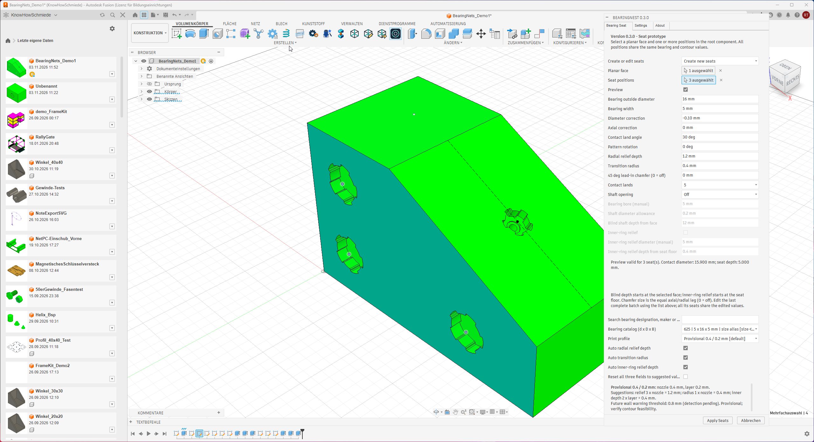

# BearingNest

Version: **0.4.0** · Status: owner confirmed 0.3.0 library and existing-seat/batch editing. New preview diagnostics and advisory wall probes await live Fusion acceptance.

BearingNest creates print-oriented ball bearing seat contours with rounded reliefs and an odd number of contact lands.

## Available in this prototype

On 2026-11-04 the owner confirmed the library and editing existing seats, including multiple seats together. See [the new 0.3.0 screenshots and earlier version-specific evidence](doku/SCREENSHOTS.md).

- `BearingNest <VERSION>` under Design > Solid > Create, with three English tabs: **Bearing Seat**, **Settings**, **About**.
- One planar face and multiple sketch points, vertices or circular edge centers as seat positions, with shared settings.
- Manual bearing outside diameter/width, diameter and axial corrections, 3/5/7/9 lands, contact angle, rotation, radial relief depth and transition radius.
- Shared construction of [confirmed contour A](doku/CONTOUR_PROPOSAL.md), cut preview enabled by default and an **Apply Seats** action. Preview can be switched off.
- Checks of every complete solid cutting tool against the selected body, remaining floor and all other proposed seats before the first cut. An invalid position rejects the entire batch.
- Collected placement/breakout/overlap diagnostics with red approximate markers for invalid positions and blue markers for other resolved candidates in a rejected batch.
- Advisory wall/floor/inter-seat margin probes using the selected profile's nozzle-based threshold. Amber markers and text warnings allow creation; conservative envelopes can give additional warnings and do not measure exact minimum thickness. Through All shaft walls are excluded from these probes.
- Optional shaft opening: Off, Through All or face-referenced Blind depth; positive allowance added to the manual bearing bore.
- Optional manual inner-ring relief starting at the seat floor, with its own diameter and depth.
- Optional 45-degree lead-in chamfer with equal axial/radial legs; 0 mm disables it. A conservative enclosing-cylinder preflight may reject close placements.
- A versioned snapshot per seat with direct-cut, clearance and chamfer references, stable seat identity and creation-batch identity. Validation tool extrusions are removed before cutting.
- A Create or edit seats list reloads saved batches. The last complete batch can be rebuilt with shared settings; downstream features, timeline groups and missing/ambiguous references block editing.
- Searchable verified seed sizes 623/624/625/608, custom bearing records with sources and optional purchasing URLs, and manual dimension overrides.
- Named print profiles with per-field Auto/Manual settings, reset to suggestions, versioned local JSON storage and validated import/export. Existing seats keep independent bearing/profile snapshots.
- Contour sketches hidden after cutting, with profiles kept enabled for feature calculation; successful creation also hides profile fills on selected placement sketches while preserving points, curves and sketch visibility.

The prototype supports a single solid body in the root component of a parametric design. Further seed sizes, exact minimum-wall analysis and editing with downstream features remain pending. Owner feedback confirms library use and existing-seat/batch editing in 0.3.0, while specific save/reopen, failure, cancel, undo/redo, profile/import/export and macOS cases still need recorded acceptance. The new 0.4.0 markers and advisory probes also need live proof. See the [preview/wall guide](doku/PREVIEW_AND_WALLS.md) and [catalog/profile guide](doku/CATALOG_AND_PROFILES.md).

## Install and try

Use the complete [BearingNest add-in folder](Fusion-Add-In/BearingNest). If Fusion loads a copy from its AddIns directory, update that entire copy before restarting the add-in. Restarting alone does not copy repository changes.

Follow the [installation and test guide](doku/INSTALLATION.md), including the [new clearance tests](doku/SHAFT_AND_RELIEF.md), on a disposable design. Preview and creation were confirmed in 0.1.5 after fixing premature profile suppression. The owner reported a missing Through All shaft in 0.1.6. The owner confirmed shaft opening and inner-ring relief working in 0.1.7. The owner reported no observed errors while testing 0.1.8 on 2026-11-03. This is a general trial report, not a completed matrix of every acceptance case. The bore preset previews/creates the seat and shaft without an additional relief cut; a larger drawing-based diameter enables actual relief.

Target environments are Autodesk Fusion on Windows and macOS with Fusion's bundled Python. No third-party Python packages are required. The latest owner screenshots show Windows and version 0.3.0; the Fusion build was not supplied. Separate chamfer/cancel/undo acceptance, new 0.4.0 graphics and macOS remain unverified.

## Version maintenance

The only manually maintained current release version is [version.py](Fusion-Add-In/BearingNest/version.py). After changing it, run `python tools/sync_version.py` to update the Fusion manifest and this README header. Check with `python tools/sync_version.py --check`. Plugin displays import the same constant. Historical milestone and changelog versions stay unchanged.

## Project documents

- [Agent and implementation instructions](doku/AGENTS.md)
- [Functional specification](doku/SPECIFICATION.md)
- [Roadmap](doku/ROADMAP.md)
- [Changelog](CHANGELOG.md)
- [Contour A](doku/CONTOUR_PROPOSAL.md)
- [Screenshots of 0.3.0 and earlier confirmed baselines](doku/SCREENSHOTS.md)
- [Shaft opening and inner-ring relief](doku/SHAFT_AND_RELIEF.md)
- [Persistence, batch editing and remaining live proof](doku/PERSISTENCE_PROTOTYPE.md)
- [Bearing catalog, named print profiles and local settings](doku/CATALOG_AND_PROFILES.md)
- [Preview diagnostics and advisory wall margins](doku/PREVIEW_AND_WALLS.md)
- [API notes and verification status](doku/API_NOTES.md)
- Visual assets: [logo](images/logo.svg), [banner](images/banner.svg), [bearing seat icon](images/bearing-seat.svg)

The owner's Python template supplies the run/stop entry points, command registry and Autodesk event utilities. Palette examples remain inactive.

Product and documentation language is English. German localization is planned near completion.

Licensed under the [MIT License](LICENSE). Bundled Autodesk utilities retain their [original notices](THIRD_PARTY_NOTICES.md). Manual example dimensions are not manufacturer-verified catalog records.
