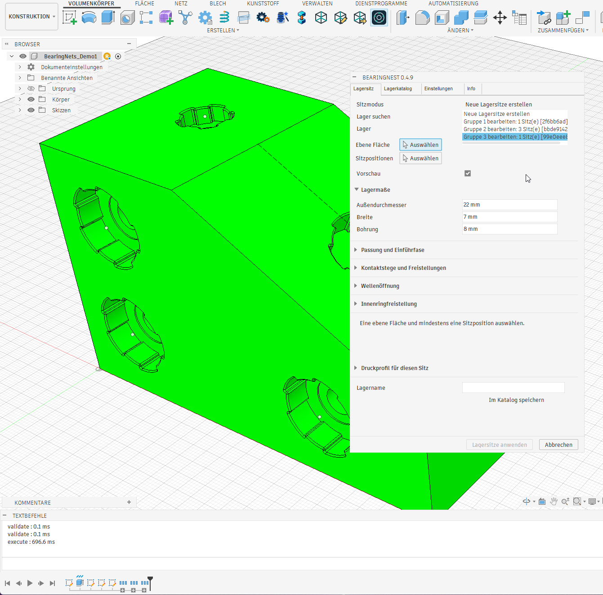
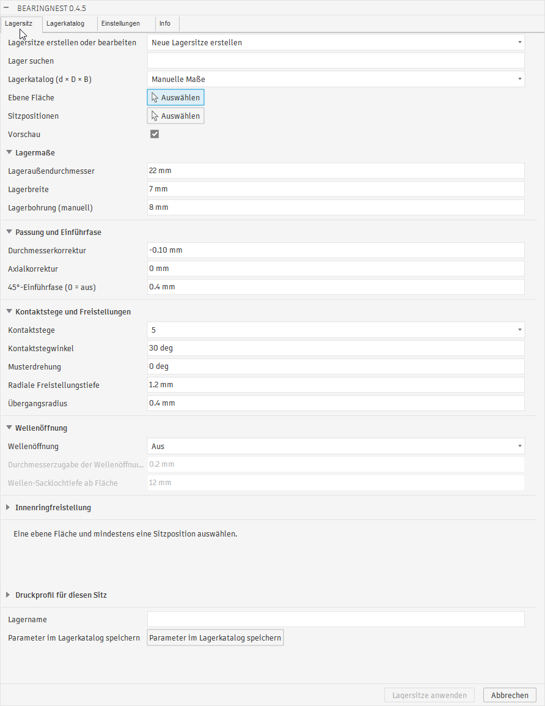

# BearingNest

Version: **0.4.9** · Status: owner confirmed 0.3.0 library and existing-seat/batch editing. New preview diagnostics and advisory wall probes await live Fusion acceptance.

BearingNest creates print-oriented ball bearing seat contours with rounded reliefs and an odd number of contact lands.

## Available in this prototype

Version 0.4.9 collects each committed seat batch in a collapsed timeline group named like its Seat mode entry. The owner confirmed that grouping works on 2026-11-07.

See the [0.4.9 screenshot and trial notes](doku/SCREENSHOTS.md#049-seat-mode-and-timeline-groups-german). Earlier version-specific screenshots remain below and in the screenshot guide.

The 0.4.8 action buttons (catalog/profile save/delete, reset and import/export) also align with the right-hand control column. Face and position pickers retain Fusion's native placement: SelectionCommandInputs are not supported inside native tables, so those two controls are not exactly aligned to the table columns.

Version 0.4.8 gives shared two-column forms **50:50 label/control widths** across Bearing Seat, Bearing Catalog and Settings, improving label readability. This also includes Bearing Seat's seat mode, search, catalog choice and bearing-name fields, previously left in Fusion's native-width layout. Separate header/Preview/name sections preserve their positions. The owner confirmed the latest 0.4.7 preview/selection flow works; native acceptance of the new column ratio remains pending.

The latest 0.4.7 correction retains source-selection tokens before temporary cuts, addressing face loss when switching Preview off. Explicit face/point changes invalidate the corresponding baseline. The original face-loss error was reproduced directly in Fusion; acceptance of the corrected token handling is pending after updating the add-in.

Native diagnosis of the latest missing-preview report found a Fusion API return mismatch: fireCustomEvent returned False while still delivering its event. The current 0.4.7 queue retains such requests until delivery, keeps the registered event object alive and reports only actual exceptions as enqueue failures. This mismatch was verified directly in Fusion; full value-change preview acceptance after updating the add-in remains pending.

The latest 0.4.7 correction defers explicit preview requests to Fusion's idle queue and coalesces duplicate notifications. It preserves face/multi-point selections across preview rollback while respecting deliberate deselection. This replaces the synchronous request that the owner reported could lose the selected point. Native confirmation of selection preservation is pending; automated tests simulate selection loss before and after the host callback.

Version 0.4.7 now replays an already validated new-seat preview as transient graphics after layout-only group changes, avoiding repeated feature construction. Parameter/selection changes invalidate this copy; Apply Seats always rebuilds and validates real geometry. Existing-batch edits retain full preview rebuilding. The owner trace showed 228–234 ms per repeated preview handler, with further latency outside the handlers. Buffered timings distinguish rebuild/replay in Fusion's Text Commands window after closing. Follow the [diagnostic comparison](doku/INSTALLATION.md#diagnosing-slow-group-expansion-047); native speedup, selection, appearance restoration and cancel/undo acceptance of this replay revision remain pending.

Version 0.4.6 opens only the bearing-dimensions groups by default; all other groups start collapsed on every command opening. Numeric inputs use separate label/value columns (50:50). Contact-land and shaft-mode selectors align with the right column; Preview and Inner-ring relief checkboxes also use the right column for layout review. Buttons and long field labels use concise wording with their full previous labels retained in tooltips. Seat, catalog and profile values have English/German help describing units, signs and depth references. The 42 layout rows share 9 native tables to reduce layout overhead when expanding groups. The shared-table optimization is released as 0.4.7; native expansion speed is not yet measured. Native Fusion resizing, checkbox placement and tooltip acceptance remain pending.

Version 0.4.5 uses a known catalog inner-ring outside diameter as the inner-ring relief diameter suggestion when selecting a bearing. No extra clearance is added. Manual preset values and existing seat snapshots are retained; unknown ring dimensions still use the bore placeholder.

Version 0.4.4 reorganizes the dialog into **Bearing Seat**, **Bearing Catalog**, **Settings** and **Info**. The short **Find bearing / Lager suchen** field includes search examples in its tooltip. Seat geometry is grouped by purpose; profile selection and Auto flags live with the seat. Settings contains reusable print profiles and import/export. The independent catalog editor supports selecting, editing, saving and deleting local bearings, including complete seat presets; built-in sizes are saved as custom copies. Info links to the project/download, issue tracker, Know-How-Schmiede YouTube channel and homepage. Native Fusion layout and interaction acceptance is pending.

Version 0.4.3 loads all stored seat settings, profile/Auto flags, name and metadata when a catalog entry is selected. Both catalog save actions retain complete presets. Older dimension-only entries load standard seat/profile settings with their bearing dimensions; resave them to retain custom settings. See [catalog behavior and acceptance checks](doku/CATALOG_AND_PROFILES.md).

Version 0.4.2 streamlines Bearing Seat: catalog selection follows the create/edit selector, print-profile controls live under Settings, and new seats start with a 0.4 mm lead-in chamfer. Below preview status, enter a bearing name and click **Save parameters to bearing catalog / Parameter im Lagerkatalog speichern**. This immediately creates a new local entry with dimensions, seat parameters, profile and Auto flags; selecting it restores these values. Geometry Cancel does not undo a library save. Existing dimension-only records remain supported.

The owner-supplied 0.4.5 screenshots from 2026-11-07 show all four German tabs: [Bearing Seat, Bearing Catalog, Settings and Info](doku/SCREENSHOTS.md#045-bearing-seat-tab-german). They document the dialog before the 0.4.6 compact-field and startup-group changes; they do not establish acceptance of those later changes.

On 2026-11-04 the owner confirmed the library and editing existing seats, including multiple seats together. See [the new 0.3.0 screenshots and earlier version-specific evidence](doku/SCREENSHOTS.md).

- `BearingNest <VERSION>` under Design > Solid > Create, with four localized tabs: **Bearing Seat / Lagersitz**, **Bearing Catalog / Lagerkatalog**, **Settings / Einstellungen**, **Info**.
- German UI follows Fusion's user-language preference; English is the fallback. Restart the add-in after changing Fusion's language. Dialog labels, help, status and wall warnings are translated; technical geometry/storage exception details and built-in profile names remain English. Saved data and user-entered names are preserved. German native layout and preview/edit acceptance still require a Fusion trial.
- One planar face and multiple sketch points, vertices or circular edge centers as seat positions, with shared settings.
- Manual bearing outside diameter/width, diameter and axial corrections, 3/5/7/9 lands, contact angle, rotation, radial relief depth and transition radius.
- Shared construction of [confirmed contour A](doku/CONTOUR_PROPOSAL.md), cut preview enabled by default and an **Apply Seats** action. Preview can be switched off.
- Checks of every complete solid cutting tool against the selected body, remaining floor and all other proposed seats before the first cut. An invalid position rejects the entire batch.
- Collected placement/breakout/overlap diagnostics with red approximate markers for invalid positions and blue markers for other resolved candidates in a rejected batch.
- Advisory wall/floor/inter-seat margin probes using the selected profile's nozzle-based threshold. Amber markers and text warnings allow creation; conservative envelopes can give additional warnings and do not measure exact minimum thickness. Through All shaft walls are excluded from these probes.
- Optional shaft opening: Off, Through All or face-referenced Blind depth; positive allowance added to the manual bearing bore.
- Optional manual inner-ring relief starting at the seat floor, with its own diameter and depth.
- Optional 45-degree lead-in chamfer with equal axial/radial legs; 0 mm disables it. A conservative enclosing-cylinder preflight may reject close placements.
- A versioned snapshot per seat with direct-cut, clearance and chamfer references, stable seat identity and creation-batch identity. Validation tool extrusions are removed before cutting.
- A Create or edit seats list reloads saved batches. Committed batches have a collapsed timeline group named like their Seat mode entry. The last complete batch can be rebuilt with shared settings, including within its own expanded or collapsed group; downstream features, unrelated group contents and missing/ambiguous references block editing.
- Searchable verified seed sizes 623/624/625/608, custom bearing records with sources and optional purchasing URLs, and manual dimension overrides.
- Named print profiles with per-field Auto/Manual settings, reset to suggestions, versioned local JSON storage and validated import/export. Existing seats keep independent bearing/profile snapshots.
- Contour sketches hidden after cutting, with profiles kept enabled for feature calculation; successful creation also hides profile fills on selected placement sketches while preserving points, curves and sketch visibility.

The prototype supports a single solid body in the root component of a parametric design. Further seed sizes, exact minimum-wall analysis and editing with downstream features remain pending. Owner feedback confirms library use and existing-seat/batch editing in 0.3.0, while specific save/reopen, failure, cancel, undo/redo, profile/import/export and macOS cases still need recorded acceptance. The new 0.4.0 markers and advisory probes also need live proof. See the [preview/wall guide](doku/PREVIEW_AND_WALLS.md) and [catalog/profile guide](doku/CATALOG_AND_PROFILES.md).

## Install and try

Use the complete [BearingNest add-in folder](Fusion-Add-In/BearingNest). If Fusion loads a copy from its AddIns directory, update that entire copy before restarting the add-in. Restarting alone does not copy repository changes.

Follow the [installation and test guide](doku/INSTALLATION.md), including the [new clearance tests](doku/SHAFT_AND_RELIEF.md), on a disposable design. Preview and creation were confirmed in 0.1.5 after fixing premature profile suppression. The owner reported a missing Through All shaft in 0.1.6. The owner confirmed shaft opening and inner-ring relief working in 0.1.7. The owner reported no observed errors while testing 0.1.8 on 2026-11-03. This is a general trial report, not a completed matrix of every acceptance case. The bore preset previews/creates the seat and shaft without an additional relief cut; a larger drawing-based diameter enables actual relief.

Target environments are Autodesk Fusion on Windows and macOS with Fusion's bundled Python. No third-party Python packages are required. The latest owner screenshot shows Windows and the German version 0.4.9 dialog; the Fusion build was not supplied. Separate chamfer/cancel/undo acceptance, diagnostic graphics and macOS remain unverified.

## Version maintenance

The only manually maintained current release version is [version.py](Fusion-Add-In/BearingNest/version.py). After changing it, run `python tools/sync_version.py` to update the Fusion manifest and this README header. Check with `python tools/sync_version.py --check`. Plugin displays import the same constant. Historical milestone and changelog versions stay unchanged.

## Project documents

- [Agent and implementation instructions](doku/AGENTS.md)
- [Functional specification](doku/SPECIFICATION.md)
- [Roadmap](doku/ROADMAP.md)
- [Changelog](CHANGELOG.md)
- [Contour A](doku/CONTOUR_PROPOSAL.md)
- [Screenshots of 0.4.9 timeline groups, the 0.4.5 dialog and earlier baselines](doku/SCREENSHOTS.md)
- [Shaft opening and inner-ring relief](doku/SHAFT_AND_RELIEF.md)
- [Persistence, batch editing and remaining live proof](doku/PERSISTENCE_PROTOTYPE.md)
- [Bearing catalog, named print profiles and local settings](doku/CATALOG_AND_PROFILES.md)
- [Preview diagnostics and advisory wall margins](doku/PREVIEW_AND_WALLS.md)
- [API notes and verification status](doku/API_NOTES.md)
- Visual assets: [logo](images/logo.svg), [banner](images/banner.svg), [bearing seat icon](images/bearing-seat.svg)

The owner's Python template supplies the run/stop entry points, command registry and Autodesk event utilities. Palette examples remain inactive.

Product and documentation language is English. German localization is planned near completion.

Licensed under the [MIT License](LICENSE). Bundled Autodesk utilities retain their [original notices](THIRD_PARTY_NOTICES.md). Manual example dimensions are not manufacturer-verified catalog records.
