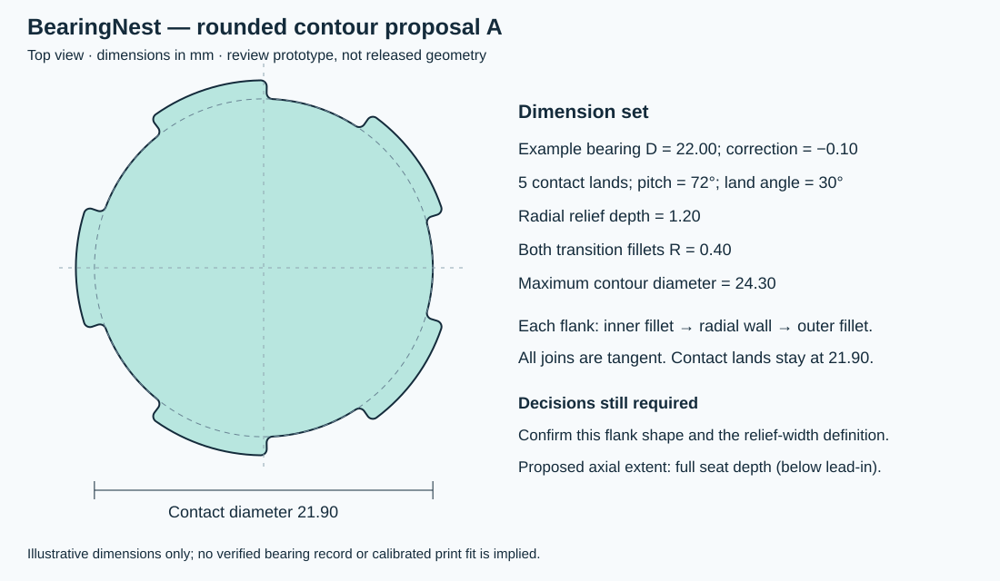

# Rounded seat contour — proposal A

Status: construction A confirmed by the owner for the 0.2.0 prototype, including derived transition width and full axial seat depth. The add-in now uses the shared contour implementation for a single-seat cut; live Fusion validation is still required.

## Example dimensions

| Parameter | Value |
|---|---:|
| Illustrative bearing outside diameter | 22.00 mm |
| Diameter correction | −0.10 mm |
| Contact diameter | 21.90 mm |
| Contact land count | 5 |
| Angular pitch | 72° |
| Actual contact angle per land | 30° |
| Radial relief depth | 1.20 mm |
| Inner and outer transition radius | 0.40 mm |
| Maximum contour diameter | 24.30 mm |

These are illustrative dimensions, not a manufacturer-verified bearing entry or a calibrated print fit.

## Proposed construction

Each land is a concentric circular contact arc. Moving away from a land toward the next relief, the contour follows an inner circular fillet, a straight radial wall and an outer circular fillet. A concentric relief arc connects the two flanks between adjacent lands. All connections have matching tangents; the contact angle refers to the remaining contact arc after the transitions.

Let `r = (D + correction) / 2`, `R = r + relief_depth`, `f = transition_radius`, `p = 2π / count` and `a = land_angle / 2`, with angles in radians. For the first flank:

- The radial wall angle is `α = a + asin(f / (r + f))`.
- The outer relief arc starts at `β = α + asin(f / (R − f))`.
- The inner fillet center is at radius `r + f`, angle `a`.
- The outer fillet center is at radius `R − f`, angle `β`.
- Radial wall endpoints have radii `sqrt((r + f)² − f²)` and `sqrt((R − f)² − f²)`.
- Mirror the flank about the relief's angular midpoint and repeat around the seat.

Reject a contour when the outer wall endpoint is not beyond the inner endpoint, or when `2β >= p`. Invalid dimensions are reported rather than silently reduced.

## Confirmed construction decisions

1. **Flank shape:** use the two circular fillets and radial wall shown above. This creates a relief arc between lands rather than two isolated relief pockets flanking each land.
2. **Width definition:** with this construction, the tangential transition width is derived from `r`, `R` and `f`. The unwrapped approximation is `2f = 0.80 mm`; it is not an independently adjustable exact width. The earlier provisional side-relief width of `2 × nozzle diameter` therefore needs clarification: does it mean this transition width, the complete gap between lands, or the width of separate pockets? Do not implement an independent width input by silently overriding the radius or land angle.
3. **Axial extent:** proposed full seat depth below the lead-in, ending at the seat floor. Inner-ring relief remains a separate deeper cut. A partial-depth side relief would require an additional axial parameter.

## Reproduction and checks

Run `python tools/contour_prototype.py` to regenerate the SVG. It imports the same pure `contour_geometry.py` used by the add-in. Automated checks verify closed contours and tangent continuity for 3, 5, 7 and 9 lands, and reject example infeasible dimensions. They do not prove manufacturability or Fusion feature creation.

The owner selected this complete proposal. The single-seat geometry prototype writes snapshots on commit. Actual geometry updates and file-reopen behavior still need implementation and live proof.
