# BearingNest in Fusion

These owner-supplied screenshots document the German **0.4.5** dialog and the earlier **0.3.0**, **0.1.7** and **0.1.5** baselines. The four 0.4.5 images were supplied on 2026-11-07 and show all four tabs. They precede the compact numeric fields, startup group states and tooltips introduced in 0.4.6; expanded/collapsed groups in these images do not establish startup defaults. They do not demonstrate catalog ring-diameter transfer or completed save/delete/link actions.

On 2026-11-04 the owner confirmed that the library works and existing seats can be edited, including several seats together. This is a live usage report, not a completed test matrix for save/reopen, cancellation, undo/redo, import/export or every profile operation. No screenshot below documents diagnostic markers or wall warnings.

## 0.4.5: Bearing Seat tab (German)

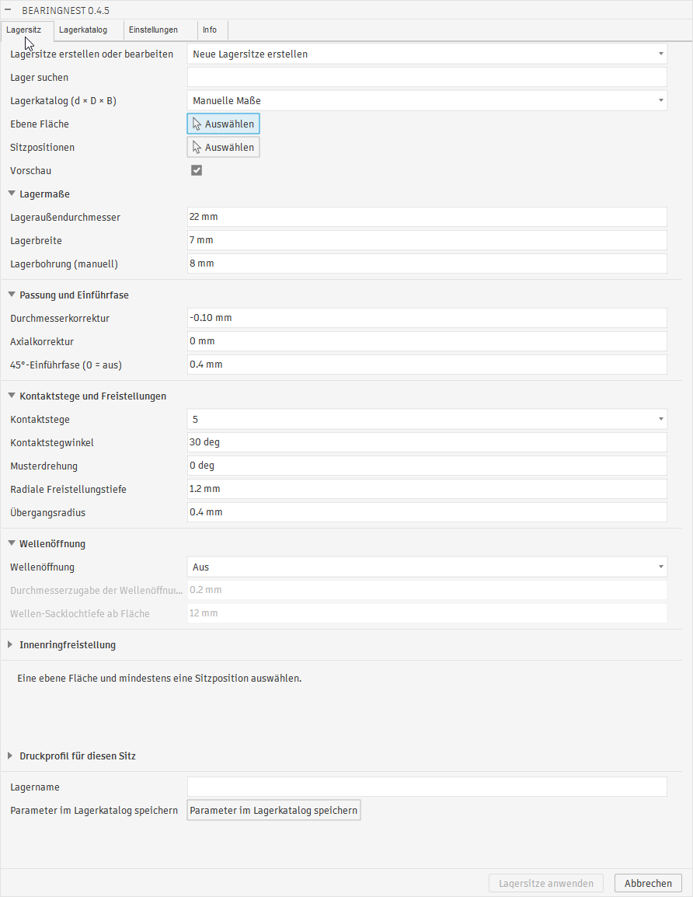

The dialog shows the four tabs **Lagersitz**, **Lagerkatalog**, **Einstellungen** and **Info**. Bearing Seat includes the short **Lager suchen** field and groups for bearing dimensions, fit/chamfer, contact lands, shaft opening, inner-ring relief and the seat's print profile. The visible values are 22 mm outside diameter, 7 mm width, 8 mm bore, -0.10 mm diameter correction, 0.4 mm chamfer and five 30-degree lands. Preview is enabled, but no face or positions are selected; Apply Seats is disabled. The named parameter-save shortcut appears at the bottom.

## 0.4.5: Bearing Catalog tab (German)

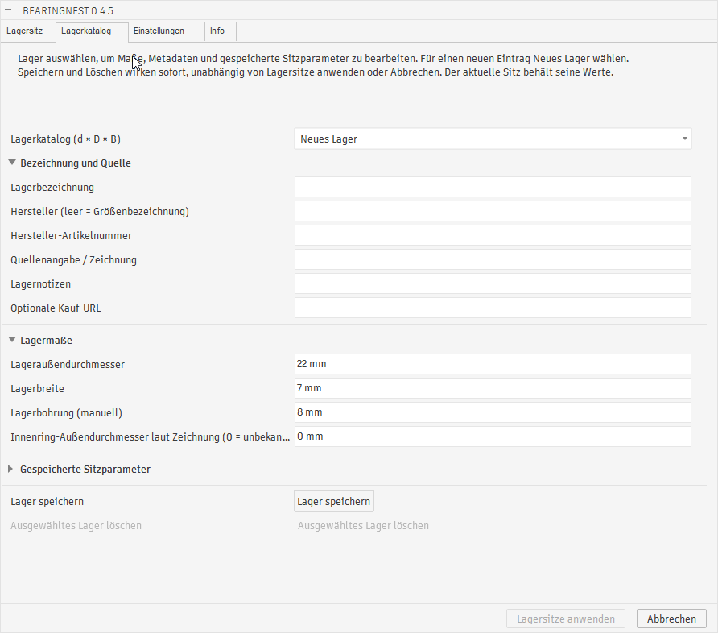

The independent catalog editor is set to **Neues Lager**. It shows designation/source metadata and bearing dimensions, including an inner-ring outside diameter of 0 mm (unknown). Saved seat parameters are collapsed. **Lager speichern** is visible; deletion is disabled because no existing custom bearing is selected. This image documents the editor layout, not a completed catalog save or the transfer of a known ring diameter to Bearing Seat.

## 0.4.5: Settings tab (German)

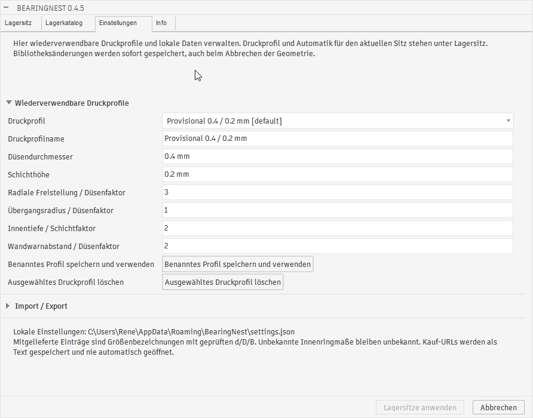

Settings contains reusable profile management with the provisional 0.4 mm nozzle / 0.2 mm layer profile. The displayed relief, transition-radius, inner-depth and wall-warning factors are 3, 1, 2 and 2. Profile save/use and delete controls are visible, while Import / Export is collapsed. The status shows the local JSON settings location and explains that unknown bearing dimensions stay unknown. No storage operation is demonstrated.

## 0.4.5: Info tab (German)

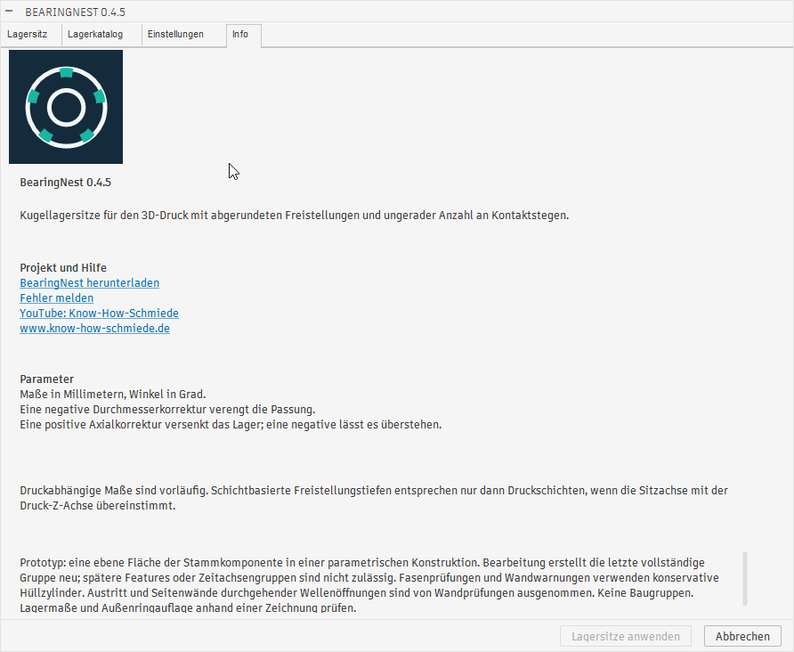

Info displays the logo and version 0.4.5, purpose, correction-sign guidance, printing notes and prototype limitations. The project/help section includes download and bug-report links, the Know-How-Schmiede YouTube channel and www.know-how-schmiede.de. The screenshot confirms their displayed presence, not that the links were opened.

## 0.3.0: catalog selection and three-position preview

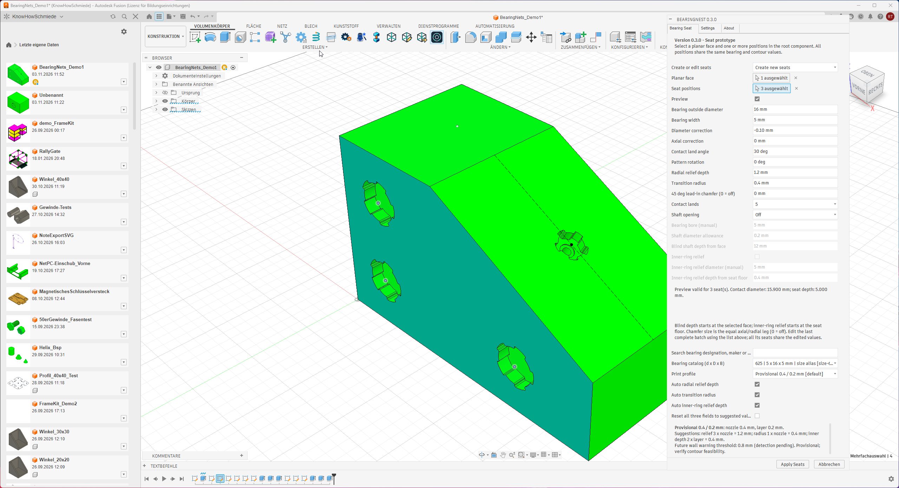

The active command shows one selected face, three selected positions, catalog size 625 (5 x 16 x 5 mm), five 30-degree lands and Preview enabled. The status reports a valid preview for three seats, a 15.900 mm contact diameter and a 5.000 mm depth. Shaft opening and chamfer are off in this example. Seats on other visible faces were already present; this does not establish a single multi-face batch. The separate owner report confirms editing existing seats and whole batches; the screenshot itself shows **Create new seats**.

## 0.3.0: Bearing Seat tab

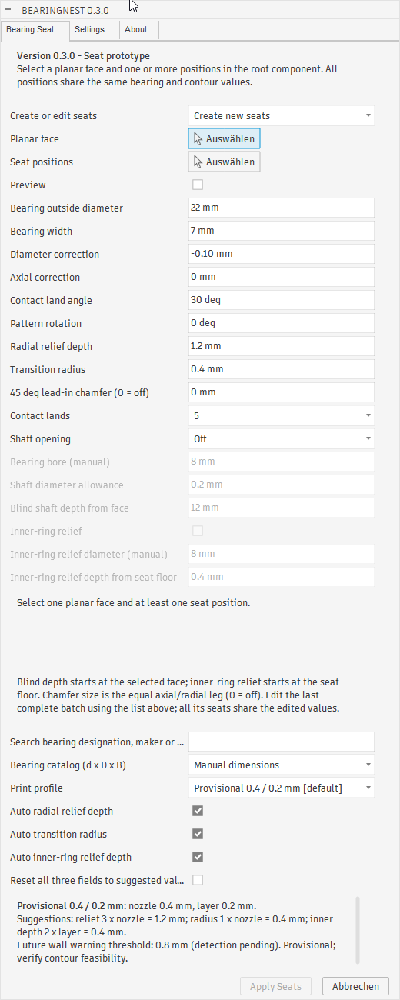

The complete dialog shows manual bearing values, batch selection, shaft/relief controls, catalog search and the provisional 0.4 mm nozzle / 0.2 mm layer profile. All three derived fields are Auto. Preview is unchecked in this historical 0.3.0 screenshot; **0.4.0 changes the startup default to on**.

## 0.3.0: Settings tab

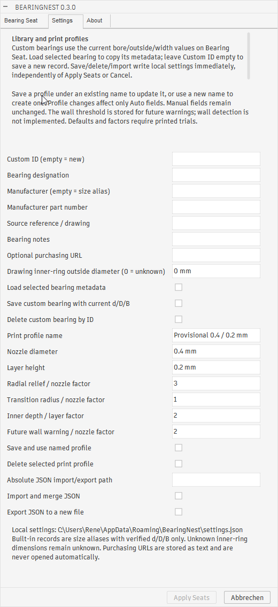

The Settings tab contains custom identity, designation, manufacturer/part number, source, notes, optional purchasing URL and an unknown inner-ring diameter represented by 0 in the editor. It also shows print profile factors, local settings actions and JSON import/export. Its wording describes wall warnings as pending in 0.3.0; conservative advisory probes are introduced in 0.4.0. The screenshot shows the controls, not proof that every settings action was exercised.

## 0.1.7: shaft opening and inner-ring relief

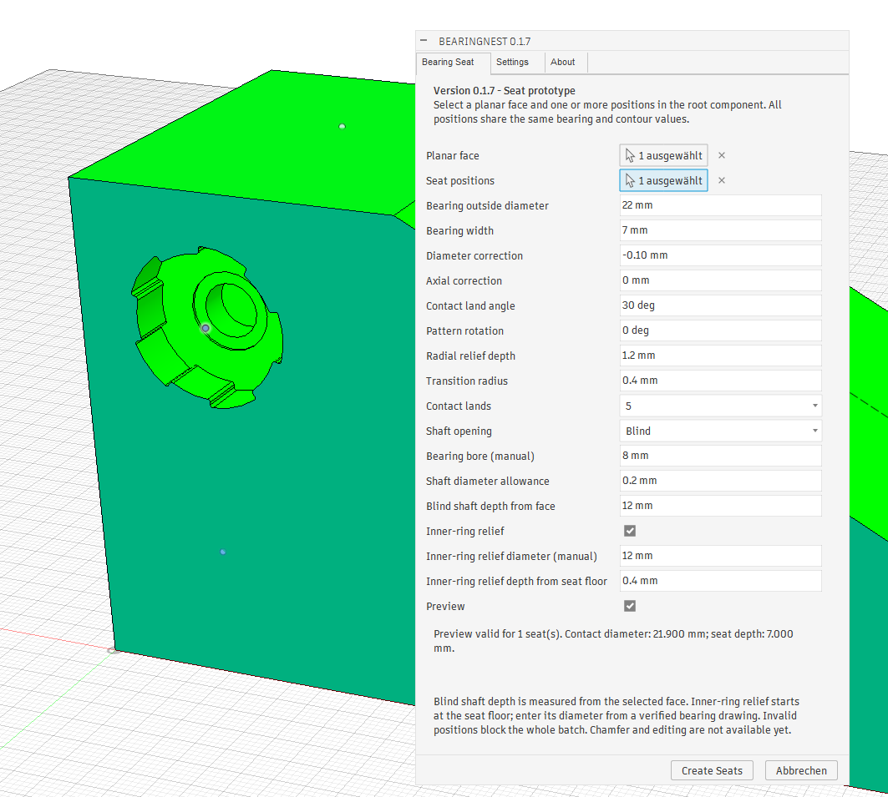

This earlier screenshot shows a 22 x 7 mm seat, an 8 mm bearing bore, 0.2 mm shaft allowance, a face-referenced 12 mm blind opening, and a manual 12 mm diameter / 0.4 mm deep inner-ring relief. The status reports one valid seat preview. The owner confirmed shaft/relief operation in 0.1.7; this image predates catalog/profile controls and editable batches.

## Historical 0.1.5 baseline

The four images below record the owner-confirmed 2026-11-03 baseline, before shaft/relief, catalog/profile and batch-edit controls.

## Seat preview on a planar inclined face

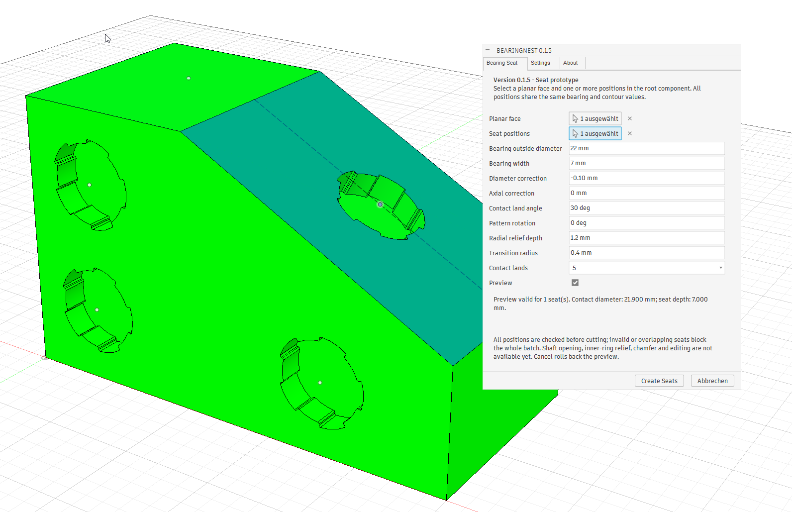

The active preview contains one selected position. The other visible seats were already present; this image alone is not proof of a single multi-face batch.

## Bearing Seat tab

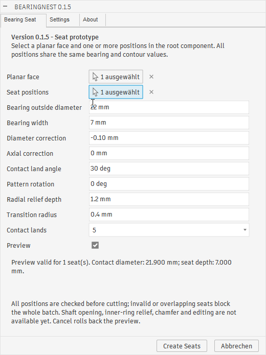

The example uses a 22 mm outside diameter, 7 mm bearing width, -0.10 mm diameter correction and five 30-degree contact lands. The displayed contact diameter is 21.900 mm and depth is 7.000 mm.

## Settings tab

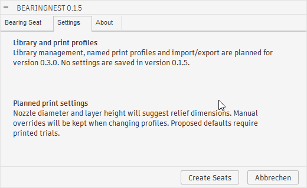

Library and print profile management were planned features in 0.1.5. This historical tab describes their intended role; the 0.3.0 implementation appears above.

## About tab

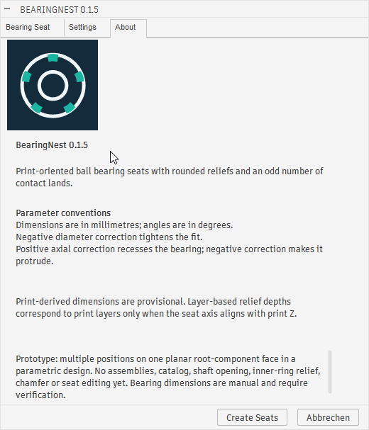

The About tab displays the logo, centrally maintained version and correction-sign guidance. Its limitations describe the historical 0.1.5 implementation.
